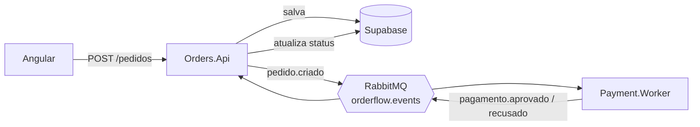

# OrderFlow

Sistema de pedidos **assíncrono** feito com .NET 8, RabbitMQ e Supabase (PostgreSQL). Projeto de estudo sobre mensageria e arquitetura orientada a eventos.

## Como funciona



1. A API recebe o pedido, salva como `Pendente` e publica o evento `pedido.criado`.
2. O `Payment.Worker` consome o evento, simula a cobrança e publica `pagamento.aprovado` ou `pagamento.recusado`.
3. A API consome o resultado e atualiza o status do pedido no banco.

Regra do demo: pedidos acima de R$ 5.000 são recusados.

## Tecnologias

- .NET 8: Minimal API, Worker Service, Entity Framework Core (migrations)
- RabbitMQ (exchange topic, filas duráveis, ack manual, prefetch)
- Supabase (PostgreSQL)
- Docker Compose
- Angular (em desenvolvimento)

## Estrutura

```
src/
  OrderFlow.Contracts/       eventos e nomes de exchange/filas compartilhados
  OrderFlow.Orders.Api/      API, EF Core, publisher e consumer
  OrderFlow.Payment.Worker/  worker que processa os pagamentos
docker-compose.yml           RabbitMQ com painel de administração
```

## Como rodar

**Pré-requisitos:** .NET 8 SDK, Docker e um projeto no Supabase.

1. Suba o RabbitMQ (painel em http://localhost:15672, usuário e senha `orderflow`):

   ```bash
   docker compose up -d
   ```

2. Configure a connection string do Supabase (use o *Session pooler*) sem expor a senha:

   ```bash
   dotnet user-secrets init --project src/OrderFlow.Orders.Api
   dotnet user-secrets set "ConnectionStrings:Supabase" "Host=SEU_HOST;Port=5432;Database=postgres;Username=postgres.SEU_PROJETO;Password=SUA_SENHA;SSL Mode=Require;Trust Server Certificate=true" --project src/OrderFlow.Orders.Api
   ```

3. Em dois terminais, rode o worker e a API (as migrations são aplicadas ao iniciar em Development):

   ```bash
   dotnet run --project src/OrderFlow.Payment.Worker
   dotnet run --project src/OrderFlow.Orders.Api
   ```

4. Abra o Swagger em `http://localhost:5134/swagger` e faça um `POST /pedidos`:

   ```json
   { "cliente": "Maria", "valor": 150 }
   ```

   Consulte `GET /pedidos/{id}`: o status passa de `Pendente` para `PagamentoAprovado` em cerca de 2 segundos.

## Roteiro

- [x] Producer e consumer com RabbitMQ, ciclo completo de eventos
- [ ] Front-end Angular com acompanhamento do status
- [ ] Notification Worker com vários consumers no mesmo exchange
- [ ] Retry com backoff, Dead Letter Queue e idempotência com `MessageId`
- [ ] Outbox Pattern e testes automatizados
- [ ] Migração para MassTransit

## Aprendizados

Producer/consumer, exchange topic, routing key e binding, mensagens persistentes, ack/nack manual, prefetch, idempotência básica e o problema do *dual write*.
