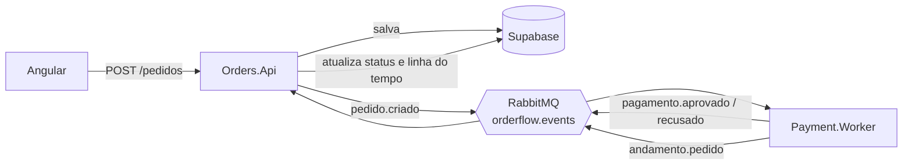
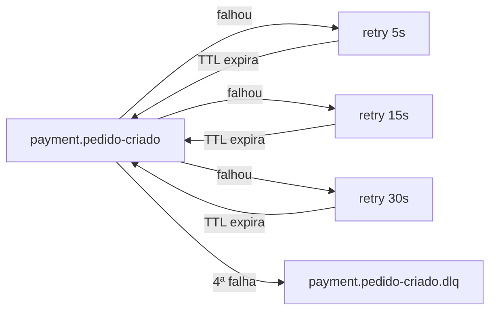

# OrderFlow


Sistema de pedidos **assíncrono** feito com .NET 8, RabbitMQ e Supabase (PostgreSQL). A API responde na hora e o pagamento é processado em segundo plano por um serviço separado, com **retry com backoff**, **Dead Letter Queue** e uma **linha do tempo** de cada pedido.

Projeto de estudo sobre mensageria e arquitetura orientada a eventos.

> Front-end em Angular: [orderflow-web](https://github.com/julioweeb/orderflow-web)


## Como funciona



1. A API recebe o pedido, salva como `Pendente` e publica `pedido.criado`. Responde `202` sem esperar o pagamento.
2. O `Payment.Worker` consome o evento, simula a cobrança e publica `pagamento.aprovado` ou `pagamento.recusado`.
3. A API consome o resultado e atualiza o status do pedido.
4. Cada etapa também vira um evento `andamento.pedido`, que a API grava na linha do tempo do pedido.

Regra do demo: pedidos acima de **R$ 5.000** são recusados.

## Retry com backoff e Dead Letter Queue

Quando o pagamento falha, a mensagem não é descartada. Ela vai para uma **fila de espera** (sem consumidor, com TTL) e, quando o tempo acaba, volta sozinha para a fila principal. A espera cresce a cada falha. Esgotadas as tentativas, a mensagem fica na **DLQ**, com o erro registrado nos headers.



A mensagem só é confirmada (`ack`) depois de ser reenfileirada, então ela pode chegar duplicada, mas nunca se perde (*at-least-once*).

## Topologia do RabbitMQ

| Item | Nome | Tipo / uso |
|---|---|---|
| Exchange | `orderflow.events` | topic, durável |
| Fila | `payment.pedido-criado` | consumida pelo Payment.Worker (`pedido.criado`) |
| Filas | `payment.pedido-criado.retry.5s / 15s / 30s` | espera do retry (TTL + dead-letter) |
| Fila | `payment.pedido-criado.dlq` | mensagens que esgotaram as tentativas |
| Fila | `orders.pagamento-processado` | consumida pela API (`pagamento.*`) |
| Fila | `orders.andamento` | consumida pela API (`andamento.pedido`) |

## Tecnologias

- **.NET 8**: Minimal API e Worker Service
- **RabbitMQ**: exchange topic, filas duráveis, ack manual, prefetch, TTL e dead-lettering
- **Supabase (PostgreSQL)** com **Entity Framework Core** (migrations)
- **Docker Compose** para o RabbitMQ
- **Angular** no front-end (repositório separado)

## Estrutura

```
src/
  OrderFlow.Contracts/       eventos e nomes de exchange, filas e routing keys
  OrderFlow.Orders.Api/      API, EF Core, publisher e consumers
  OrderFlow.Payment.Worker/  worker de pagamento (retry e DLQ)
docker-compose.yml           RabbitMQ com painel de administração
```

## Como rodar

**Pré-requisitos:** .NET 8 SDK, Docker e um projeto no Supabase.

### 1. RabbitMQ

```bash
docker compose up -d
```

Painel: http://localhost:15672 (usuário `orderflow`, senha `orderflow`).

### 2. Banco de dados (Supabase)

Use a conexão do **Session pooler** (Connect no painel do Supabase) e guarde com *user-secrets*, para a senha não ir para o Git:

```bash
dotnet user-secrets init --project src/OrderFlow.Orders.Api
dotnet user-secrets set "ConnectionStrings:Supabase" "Host=SEU_HOST;Port=5432;Database=postgres;Username=postgres.SEU_PROJETO;Password=SUA_SENHA;SSL Mode=Require;Trust Server Certificate=true" --project src/OrderFlow.Orders.Api
```

As migrations são aplicadas automaticamente ao iniciar a API em Development.

### 3. Serviços

Em dois terminais (suba o **worker primeiro**, porque é ele que declara a fila de pagamentos):

```bash
dotnet run --project src/OrderFlow.Payment.Worker
dotnet run --project src/OrderFlow.Orders.Api
```

O Swagger fica em `http://localhost:5134/swagger` (a porta aparece no log da API).

### 4. Front-end

Siga o README do [orderflow-web](https://github.com/julioweeb/orderflow-web).

## Endpoints

| Método | Rota | Descrição |
|---|---|---|
| `POST` | `/pedidos` | Cria o pedido e publica `pedido.criado` (responde `202`) |
| `GET` | `/pedidos` | Lista os 50 pedidos mais recentes |
| `GET` | `/pedidos/{id}` | Detalhes de um pedido |
| `GET` | `/pedidos/{id}/eventos` | Linha do tempo do pedido |

## Cenários de teste

O nome do cliente define o comportamento do "gateway de pagamento" simulado:

| Cliente / valor | O que acontece |
|---|---|
| Valor até R$ 5.000 | Pagamento aprovado em ~2 segundos |
| Valor acima de R$ 5.000 | Pagamento recusado |
| Nome contendo `instavel` | Falha 2 vezes e funciona na 3ª tentativa (retry) |
| Nome contendo `falha` | Falha em todas as tentativas e a mensagem vai para a DLQ |

## Decisões e trade-offs

- **Dual write:** salvar no banco e publicar na fila são dois passos separados. Se a publicação falhar depois do `SaveChanges`, o evento se perde. A solução é o **Outbox Pattern** (no roteiro).
- **At-least-once e idempotência:** a mensagem pode ser entregue mais de uma vez. O consumer da API só atualiza pedidos que ainda estão `Pendente`.
- **Retry com filas de espera** em vez de biblioteca: serve para entender o mecanismo. Depois a ideia é comparar com o MassTransit.
- **Segredos fora do repositório:** a connection string do Supabase fica em *user-secrets*.

## Roadmap

- [x] Producer e consumer com RabbitMQ, ciclo completo de eventos
- [x] Retry com backoff e Dead Letter Queue
- [x] Linha do tempo de eventos por pedido
- [x] Front-end Angular
- [ ] Status "Falhou" para pedidos que caem na DLQ
- [ ] Notification Worker (vários consumers no mesmo exchange)
- [ ] Outbox Pattern
- [ ] Testes automatizados e GitHub Actions
- [ ] Docker Compose subindo API e worker
- [ ] Migração para MassTransit
- [ ] SignalR no lugar do polling do front

## Aprendizados

Producer/consumer, exchange topic, routing key e binding, filas duráveis, mensagens persistentes, ack/nack manual, prefetch, retry com backoff via TTL, Dead Letter Queue, idempotência, o problema do *dual write*, migrations com EF Core e Supabase.

## Autor

**Julio Lima**: [GitHub](https://github.com/julioweeb) · [LinkedIn](https://www.linkedin.com/in/SEU_PERFIL)
